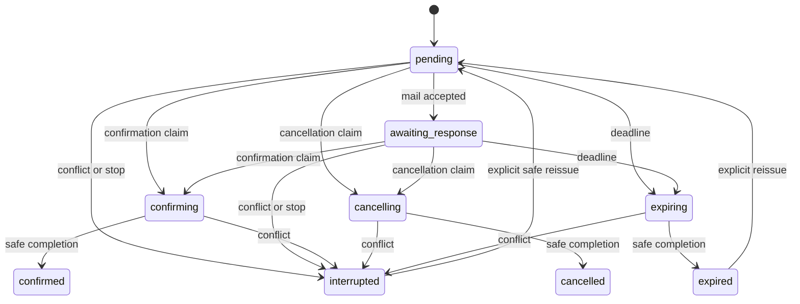

# Verification state machine

`State::TRANSITIONS` is the central allowlist. Delivery state is independent. Reissued requests reuse their row, increment generation, reset delivery and retain original creation time/history. Completed decisions cannot be reopened. Expired/interrupted requests may be explicitly reissued or manually resolved only if the original order guard still matches.

| Current state | Input | Preconditions | Side effect | Result |
|---|---|---|---|---|
| none | native COD / explicit staff start | eligible; no unique order record; safe status | insert request, optionally own hold; schedule | pending |
| pending | transport accepts initial mail | same generation, active, safe order | record acceptance | awaiting_response |
| pending / awaiting_response | customer confirms | valid bearer/challenge; unexpired; unchanged order | claim intent atomically | confirming |
| pending / awaiting_response | customer cancels | same authentication; order still held | claim intent atomically | cancelling |
| confirming | execute/reconcile | expected state or matching prior operation marker | release only plugin-owned hold; never mark paid | confirmed / manually_confirmed |
| cancelling | execute/reconcile | safe held order or matching prior operation marker | WooCommerce cancellation | cancelled / manually_cancelled |
| pending / awaiting_response | deadline | generation matches; actually expired; safe order | atomically claim expiry | expiring |
| expiring | execute/reconcile | original safety guard or matching operation | leave status; opt-in cancel only owned hold | expired |
| active / claimed | conflicting order edit / explicit stop | not already finally decided | stop future jobs; preserve staff status | interrupted |
| expired / interrupted | staff decision | explicit reason, acknowledgment; original guard still matches | same claimed transition as above | manually_confirmed / manually_cancelled |
| pending / awaiting_response / expired / interrupted | staff reissue | cooldown; eligible; original guard matches | rotate seed and hash; generation++; new deadlines/jobs | pending |
| any resolved / stale generation | replayed job or customer submission | state/generation mismatch | none | unchanged |

The first persisted claim wins. A customer decision accepted just before expiry is completed from its claim rather than defeated by a delayed expiry job. Expiration claims prevent later customer decisions. Staff can deliberately supersede an unresolved workflow through normal order edits, which remain authoritative. Arbitrary third-party direct SQL, independent shipping records and fulfillment outside WooCommerce status tracking are outside the lock protocol; see assumptions.
